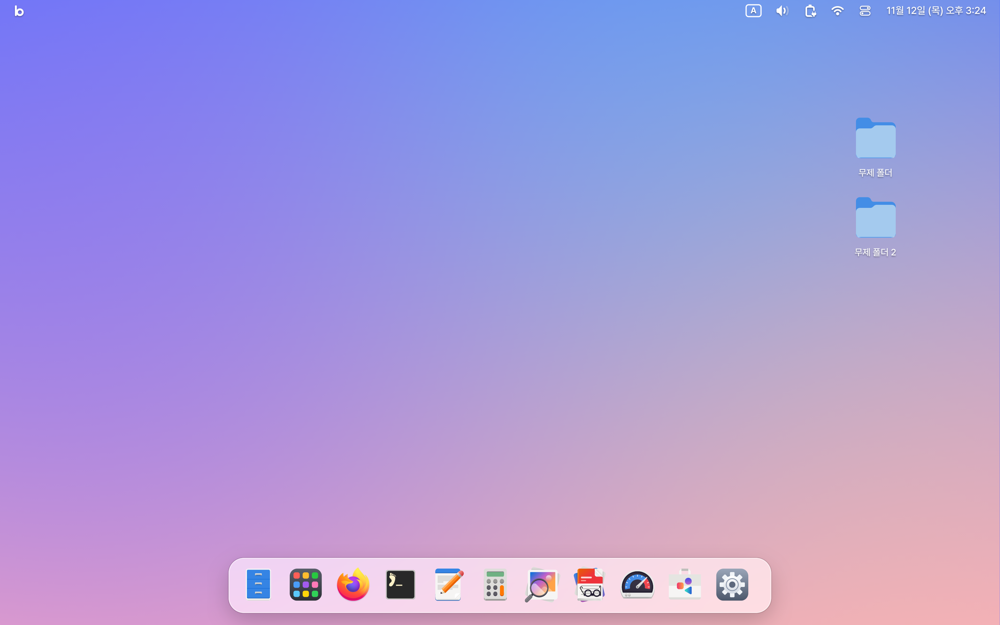
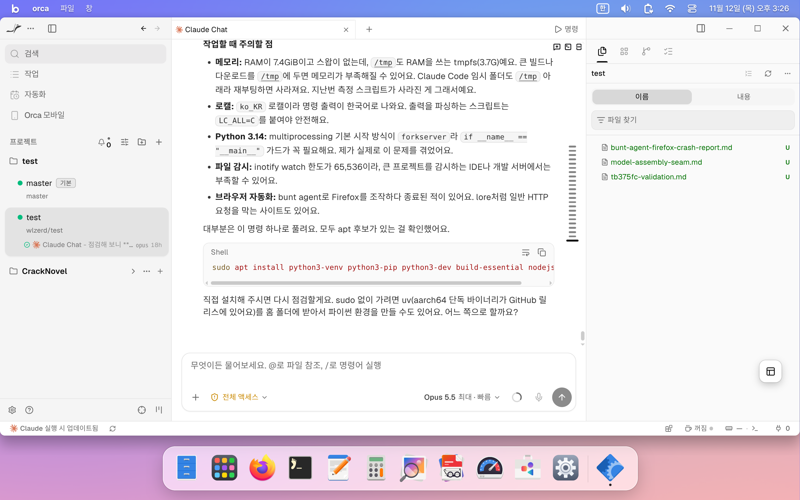

<a href="README.md">English</a> · <strong>한국어</strong>

# Lenovo Xiaoxin Pad Pro 12.7 (TB375FC)용 buntOS

buntOS는 Debian과 mainline 리눅스, 그리고 Rust와 Smithay로 만든 자체 Wayland 컴포지터 위에 세운 열린 데스크톱 OS입니다. 이 저장소는 buntOS 태블릿 라인의 첫 기기입니다. MediaTek Dimensity 8300(MT6897) 태블릿인 **Lenovo Xiaoxin Pad Pro 12.7 (2025, TB375FC)**에 mainline 리눅스 7.2를 포팅하고, 그 위에서 buntOS 데스크톱을 돌립니다.

메인 CPU에서 도는 것은 모두 오픈소스입니다. 펌웨어만 예외이며, 이 저장소에 넣지 않고 각자의 기기에서 뽑아 씁니다.

> [!WARNING]
> 개발 중인 저장소이며 정식 배포판이 아닙니다.
> - 설치기가 없습니다. 태블릿에 올리려면 커뮤니티 도구로 부트로더를 언락하고, 내장 저장장치의 파티션을 나누고, 손으로 구워야 합니다. 실수하면 기기가 벽돌이 될 수 있습니다.
> - Debian forky(testing) 스냅숏 기반이라 보안 지원이 없습니다.
> - 문서는 대부분 한국어입니다.

*태블릿의 2944×1840 화면에 뜬 buntOS 데스크톱입니다. UI는 한국어로 두었습니다. 두 스크린샷 모두 기기에서 찍었습니다.*

*AI 코딩 에이전트를 여럿 함께 돌리는 IDE인 Orca가 태블릿에서 네이티브로(arm64, Wayland) 돕니다. 안의 Claude 채팅은 이 태블릿의 개발 환경을 정리하고 있습니다.*

## 되는 것

기기에서 확인했습니다.

| 영역 | 상태 |
|---|---|
| 부팅 | 순정 부트로더(LK)가 슬롯 `_b`에서 mainline 리눅스 7.2.12를 띄웁니다. 루트 파일 시스템(btrfs)은 내장 UFS에 새로 만든 파티션에 있고, 안드로이드는 슬롯 `_a`에 남아 있습니다. |
| 화면 | 2944×1840 dual-DSI 패널이 DSC와 함께 mediatek-drm으로 144, 120, 60, 30 Hz에서 돌고, 밝기를 조절할 수 있습니다. |
| GPU | Mali-G615 MC6가 panthor와 Mesa 26.3으로 돌고, 컴포지터가 GLES로 그립니다. GPU 클럭 정책이 평소 작업을 542 MHz 이하로 두어 GPU 전원부에서 소리가 나지 않습니다. GPU를 꽉 채우는 작업에서는 이 상한이 풀립니다. |
| 입력 | 터치스크린과 포고 핀 키보드 커버가 됩니다. 커버의 트랙패드로 탭하여 클릭하기와 두 손가락 스크롤을 쓸 수 있습니다. 덮개 센서, 전원 키, 음량 키도 됩니다. |
| 무선 | MT6897 연결 서브시스템용으로 새로 만든 mt76 변형으로 Wi-Fi가 2.4·5 GHz에서 됩니다(스테이션, WPA2). Bluetooth는 AirPods, BLE 키보드와 됩니다. |
| 소리 | 스피커 넷과 내장 마이크가 PipeWire로 됩니다. |
| 전원 | USB-C 충전이 되고, PPS 직충전은 약 40 W입니다. 배터리 게이지가 되고, 잠든 동안에도 충전이 이어집니다. 그 밖에 전원 키로 깨우는 s2idle 잠자기, 10초 강제 종료, CPU 유휴 상태, 온도에 따른 클럭 제한이 됩니다. |
| 데스크톱 | buntOS 컴포지터, 셸, 시스템 설정, 화면 키보드와 한글 입력이 됩니다. 흔히 쓰는 앱(Firefox, 파일, 터미널 등)도 돕니다. |

## 아직 안 되는 것

- **입력과 포트:**
  - 스타일러스는 드라이버만 있고 기기에서 시험하지 않았습니다.
  - USB-C 이어폰, USB 호스트, DisplayPort Alt Mode가 아직 안 됩니다.
- **센서와 미디어:**
  - 카메라와 지문 센서가 안 됩니다.
  - 자동 회전과 조도 센서가 안 됩니다. 둘 다 SCP 센서 허브 뒤에 있습니다.
  - 영상 하드웨어 디코딩이 안 됩니다.
- **전원:**
  - 쓰지 않을 때 화면을 끄지 못합니다.
  - 더 깊은 잠자기가 없습니다. s2idle은 시간당 배터리를 약 1.2 % 씁니다.
  - RTC로 깨어나지 못합니다.
- **배포:** 설치기와 복구 도구가 없습니다.

## 하드웨어

| 부품 | 내용 |
|---|---|
| SoC | MediaTek MT6897(Dimensity 8300): Cortex-A715 ×4 + Cortex-A510 ×4, Mali-G615 MC6 |
| 메모리와 저장장치 | RAM 8GB 또는 12GB, UFS |
| 화면 | Novatek NT36532 패널, 2944×1840, dual-DSI + DSC, 144/120/60/30 Hz |
| 전원 | PMIC는 MT6363, MT6368, MT6319, MT6685입니다. 충전과 USB-C 포트 컨트롤러는 MT6375가 맡습니다. 차지 펌프는 UPM6720 또는 NU2115이고, 게이지는 MM8013입니다. |
| 무선 | connsys soc7_0(MT7921 계열)과 MT6637 RF |
| 그 밖 | 스피커 앰프 넷, 홀 센서 둘, UART 포고 핀 키보드 |

글로벌판 Lenovo Idea Tab Pro(TB373FU)도 하드웨어가 같습니다. 장치 트리는 있지만 그 기기에서는 시험하지 않았습니다.

## 저장소 구성

| 곳 | 내용 |
|---|---|
| `kernel/tb375fc/` | 리눅스 7.2.12 위의 커널: 패치 182개의 대기열, 장치 트리, 설정 조각, 빌드 스크립트 |
| `bsp/lenovo-tb375fc/` | 부트 이미지(boot, vendor_boot, init_boot, dtbo), initramfs, mkosi 보드 프로필, Mesa와 UPower 꾸러미, 펌웨어 추출 |
| `docs/tb375fc/` | 설계안, bring-up 체크리스트, Wi-Fi 문서 |
| `comp/`, `shell/`, `settings/` 등 | buntOS 데스크톱. 데스크톱 라인과 함께 쓰며 이 저장소로 받아 합칩니다. |

## 빌드

Debian 13 arm64에서 빌드합니다. 이 프로젝트는 맥에서 Lima VM을 씁니다([docs/dev/environment.md](docs/dev/environment.md)). 그 안에서 저장소 맨 위 폴더를 기준으로 실행합니다.

1. 커널 꾸러미: `kernel/tb375fc/build.sh image`
2. Mesa 26.3 꾸러미: `bsp/lenovo-tb375fc/mesa/build.sh`
3. UPower 꾸러미: `bsp/lenovo-tb375fc/upower/build.sh`
4. 루트 파일 시스템: `tools/image/build.sh lenovo-tb375fc`. 호스트에 빈 공간이 약 30GB 필요하고, 결과물은 `buntos.root-arm64.raw`입니다.
5. 부트 이미지와 initramfs: `bsp/lenovo-tb375fc/initramfs/mkinitramfs.sh`, `bsp/lenovo-tb375fc/boot/mkimages.sh`

자세한 것은 [kernel/tb375fc/README.md](kernel/tb375fc/README.md)와 [bsp/lenovo-tb375fc/README.md](bsp/lenovo-tb375fc/README.md)에 있습니다.

## 설치

아직 설치기가 없습니다. 이 프로젝트가 밟은 차례는 [docs/tb375fc/bringup-checklist.md](docs/tb375fc/bringup-checklist.md)에 있습니다.

1. 모든 파티션을 백업하고 되돌아갈 길을 남깁니다. 백업은 순정 펌웨어 묶음에 든 인증 DA로 SP Flash Tool을 써서 합니다.
2. 부트로더를 언락합니다. 알려진 방법은 XDA에 보고된 출처 불명의 개발용 LK 이미지를 씁니다. 이 프로젝트는 그 파일을 배포하지 않으며 안전을 보장하지 못합니다.
3. `userdata`를 줄여 루트 파티션(`buntos`)을 만들고 루트 파일 시스템을 씁니다.
4. 부트 이미지를 남는 슬롯 `_b`에 굽습니다. 안드로이드는 돌아갈 길로 슬롯 `_a`에 남깁니다.
5. 각자의 기기에서 `bsp/lenovo-tb375fc/firmware/extract.sh`로 펌웨어를 뽑습니다.

> [!CAUTION]
> 이 저장소로 만든 이미지는 개발용입니다.
> - 루트 파일 시스템을 붙이지 못하면 initramfs가 화면과 USB에 암호 없는 root 셸을 엽니다.
> - 커널 인자 `buntos.usbdebug=1`, `buntos.telnet=1`을 주면 그런 셸이 더 열립니다.
>
> 지켜야 할 자료가 있는 기기에는 쓰지 마십시오.

## 업스트림

패치는 업스트림에 낼 수 있는 꼴로 씁니다. 대기열의 고침 하나(MT6363 VSRAM LDO 레지스터)가 리눅스 7.4용 regulator 트리에 들어갔습니다. 나머지는 기기에서 시험한 뒤 보냅니다.

## 기여

기여는 DCO(Developer Certificate of Origin) 서명으로 받습니다. [CONTRIBUTING.md](CONTRIBUTING.md)를 보십시오.

## 라이선스

[REUSE](https://reuse.software/) 규격을 따릅니다. 파일마다 SPDX 머리를 달거나 [REUSE.toml](REUSE.toml)에 적고, 라이선스 원문은 [LICENSES/](LICENSES/)에 둡니다.

| 대상 | 라이선스 |
|---|---|
| buntOS 데스크톱 컴포넌트 | GPL-3.0-or-later |
| 커널 패치 | 고치는 커널 파일의 라이선스이며, 대부분 GPL-2.0-only입니다(REUSE.toml 참고) |
| 장치 트리 | GPL-2.0-only OR BSD-2-Clause |
| 문서와 스크린샷 | CC-BY-SA-4.0 |

## 고마운 곳

이 작업은 다음 위에 서 있습니다.
- 리눅스 커널과 MediaTek 업스트림 개발자들
- Mesa(Panfrost)와 panthor
- Smithay, Debian, mt76
- MT6897 커널 소스를 GPL로 공개한 OnePlus, OPPO, Motorola
- 언락 보고를 남긴 XDA 커뮤니티
- 이 태블릿의 또 다른 mainline 포트인 [u0n0u/tb375fc-linux](https://github.com/u0n0u/tb375fc-linux)

## 알림

비공식 프로젝트입니다. Lenovo, MediaTek, Apple, 그리고 스크린샷에 나온 앱을 만든 곳과 관계가 없고, 그들의 보증을 받지 않았습니다. 제품 이름, 앱 이름, 아이콘은 각 소유자의 것입니다. UI는 macOS의 관례를 따르지만 그림과 아이콘은 직접 만들었습니다.
