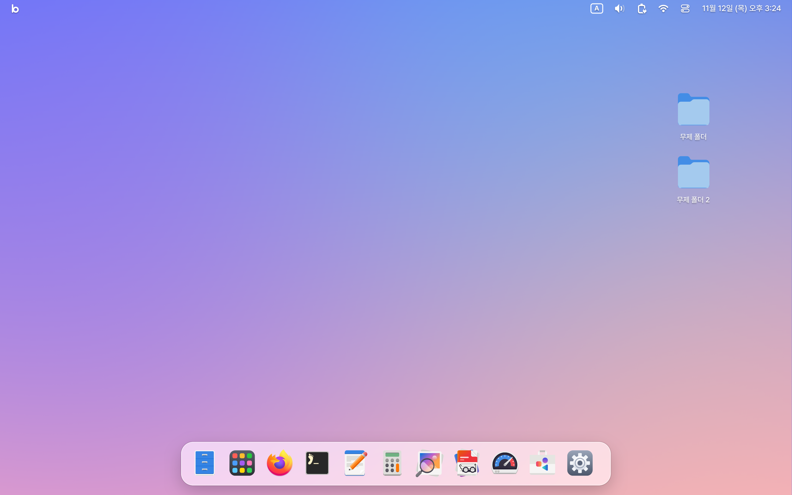
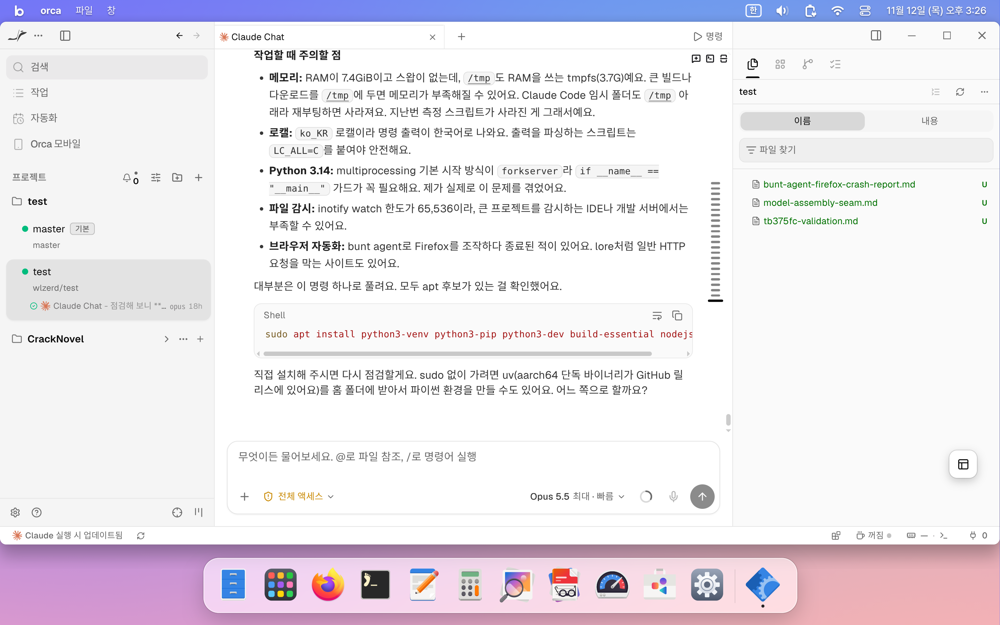

<strong>English</strong> · <a href="README.ko.md">한국어</a>

# buntOS on the Lenovo Xiaoxin Pad Pro 12.7 (TB375FC)

buntOS is an open desktop OS built on Debian, mainline Linux and its own Rust/Smithay Wayland compositor. This repository is the first device of its tablet line. It ports mainline Linux 7.2 to the **Lenovo Xiaoxin Pad Pro 12.7 (2025, TB375FC)**, a MediaTek Dimensity 8300 (MT6897) tablet, and runs the buntOS desktop on top.

Everything that runs on the main CPU is open source. Firmware is the only exception. It is not distributed here; you extract it from your own device.

> [!WARNING]
> This is a work in progress, not a release.
> - There is no installer. Putting it on a tablet means unlocking the bootloader with community tools, repartitioning the internal storage and flashing by hand. A mistake can brick the device.
> - The build is based on a Debian forky (testing) snapshot and has no security support.
> - Most of the documentation is in Korean.

*The buntOS desktop on the tablet's 2944×1840 panel, with the UI in Korean. Both screenshots were taken on the device.*

*Orca, an IDE for running AI coding agents in parallel, runs natively on the tablet (arm64, Wayland). The Claude chat in it is summing up the tablet's own development environment.*

## What works

These were tested on the device.

| Area | State |
|---|---|
| Boot | The stock bootloader (LK) boots mainline Linux 7.2.12 from slot `_b`. The root file system (btrfs) is on a new partition in the internal UFS storage, and Android stays on slot `_a`. |
| Display | The 2944×1840 dual-DSI panel with DSC runs through mediatek-drm at 144, 120, 60 or 30 Hz, with backlight control. |
| GPU | Mali-G615 MC6 runs on panthor with Mesa 26.3, and the compositor draws with GLES. A GPU clock policy keeps everyday work at or below 542 MHz, where the GPU supply stays quiet. The cap lifts for GPU-bound work. |
| Input | Touchscreen and pogo-pin keyboard cover. Its touchpad does tap to click and two-finger scrolling. The cover sensor, power key and volume keys work. |
| Wireless | Wi-Fi works on 2.4 and 5 GHz (station mode, WPA2) through a new mt76 variant for the MT6897 connectivity subsystem. Bluetooth works with AirPods and a BLE keyboard. |
| Audio | The four speakers and the built-in microphone work through PipeWire. |
| Power | USB-C charging, including PPS direct charging at about 40 W, and the battery gauge. The tablet keeps charging while asleep. Other power features that work: suspend-to-idle with power-key wake, a 10-second forced power-off, CPU idle states and thermal throttling. |
| Desktop | The buntOS compositor, shell, settings and on-screen keyboard run, with Korean input. So do the usual apps (Firefox, Files, Terminal and others). |

## Not done yet

- **Input and ports:**
  - The stylus driver is written but not tested on the device.
  - USB-C headphones, USB host mode and DisplayPort Alt Mode.
- **Sensors and media:**
  - Cameras and the fingerprint reader.
  - Auto-rotation and the ambient light sensor, which sit behind the SCP sensor hub.
  - Hardware video decoding.
- **Power:**
  - Turning the display off when idle.
  - Deeper sleep. Suspend-to-idle uses about 1.2 % of the battery per hour.
  - Waking from the RTC.
- **Distribution:** an installer and recovery tooling.

## Hardware

| Part | Details |
|---|---|
| SoC | MediaTek MT6897 (Dimensity 8300): 4× Cortex-A715 + 4× Cortex-A510, Mali-G615 MC6 |
| Memory and storage | 8 or 12 GB RAM, UFS |
| Display | Novatek NT36532 panel, 2944×1840, dual-DSI with DSC, 144/120/60/30 Hz |
| Power | MT6363, MT6368, MT6319 and MT6685 PMICs. The MT6375 is the charger and USB-C port controller. UPM6720 or NU2115 charge pumps and an MM8013 gauge complete it. |
| Wireless | connsys soc7_0 (MT7921 family) with MT6637 RF |
| Other | Four speaker amplifiers, two hall sensors and a UART pogo-pin keyboard |

The global model, the Lenovo Idea Tab Pro (TB373FU), uses the same hardware. Its device tree is here, but it has not been tested on that model.

## Repository layout

| Path | Contents |
|---|---|
| `kernel/tb375fc/` | The kernel on Linux 7.2.12: a queue of 182 patches, device trees, a config fragment and the build script |
| `bsp/lenovo-tb375fc/` | Boot images (boot, vendor_boot, init_boot, dtbo), the initramfs, the mkosi board profile, Mesa and UPower packages, and firmware extraction |
| `docs/tb375fc/` | Design, bring-up checklist and Wi-Fi notes (in Korean) |
| `comp/`, `shell/`, `settings/`, … | The buntOS desktop. It is shared with the desktop line and merged into this repository. |

## Building

Builds run on Debian 13 arm64. The project uses a Lima VM on a Mac; see [docs/dev/environment.md](docs/dev/environment.md). Run these commands from the repository root inside that machine:

1. Kernel package: `kernel/tb375fc/build.sh image`
2. Mesa 26.3 package: `bsp/lenovo-tb375fc/mesa/build.sh`
3. UPower package: `bsp/lenovo-tb375fc/upower/build.sh`
4. Root file system: `tools/image/build.sh lenovo-tb375fc`. This needs about 30 GB of free disk on the host and produces `buntos.root-arm64.raw`.
5. Boot images and initramfs: `bsp/lenovo-tb375fc/initramfs/mkinitramfs.sh` and `bsp/lenovo-tb375fc/boot/mkimages.sh`

Details are in [kernel/tb375fc/README.md](kernel/tb375fc/README.md) and [bsp/lenovo-tb375fc/README.md](bsp/lenovo-tb375fc/README.md), in Korean.

## Installing

There is no installer yet. The steps the project followed, in order, are in [docs/tb375fc/bringup-checklist.md](docs/tb375fc/bringup-checklist.md), in Korean:

1. Back up every partition and keep a way back. Use SP Flash Tool with the authorized DA from the stock firmware package.
2. Unlock the bootloader. The known route uses a development LK image of unknown origin that was reported on XDA. This project does not distribute it and cannot vouch for it.
3. Make a root partition (`buntos`) out of `userdata` and write the root file system to it.
4. Flash the boot images to the spare slot `_b`. Android stays on slot `_a` as the way back.
5. Extract the firmware from your own device with `bsp/lenovo-tb375fc/firmware/extract.sh`.

> [!CAUTION]
> Images built from this repository are development images.
> - If the root file system cannot be mounted, the initramfs opens a root shell without a password on the screen and over USB.
> - The kernel options `buntos.usbdebug=1` and `buntos.telnet=1` open more of them.
>
> Do not use these images on a device that holds data you need to protect.

## Upstream

The patches are written so that they can go upstream. One fix from the queue (the MT6363 VSRAM LDO registers) has been applied to the regulator tree for Linux 7.4. More will be sent after device testing.

## Contributing

Contributions are accepted under the Developer Certificate of Origin; see [CONTRIBUTING.md](CONTRIBUTING.md), in Korean.

## License

The repository follows [REUSE](https://reuse.software/). Each file carries SPDX headers or is covered by [REUSE.toml](REUSE.toml), and the license texts are in [LICENSES/](LICENSES/).

| Part | License |
|---|---|
| buntOS desktop components | GPL-3.0-or-later |
| Kernel patches | The license of the kernel files they change, mostly GPL-2.0-only (see REUSE.toml) |
| Device trees | GPL-2.0-only OR BSD-2-Clause |
| Documentation and screenshots | CC-BY-SA-4.0 |

## Acknowledgements

This work builds on others:
- the Linux kernel and MediaTek upstream developers
- Mesa (Panfrost) and panthor
- Smithay, Debian and mt76
- OnePlus, OPPO and Motorola, who published their MT6897 kernel sources under the GPL
- the XDA community for its unlock reports
- [u0n0u/tb375fc-linux](https://github.com/u0n0u/tb375fc-linux), another mainline port of this tablet

## Disclaimer

This is an unofficial project. It is not affiliated with or endorsed by Lenovo, MediaTek, Apple, or the makers of the apps shown in the screenshots. Product names, app names and icons belong to their owners. The UI follows macOS conventions but uses its own artwork.
