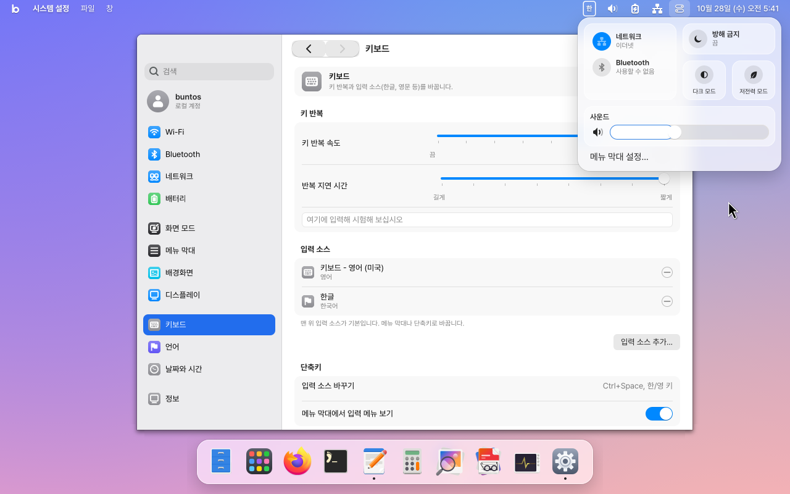

# buntOS

태블릿 폼팩터의 개발용 Unix 워크스테이션을 목표로 하는 오픈소스 OS입니다. 안드로이드 태블릿에서 막혀 있던 셸 제어, 개발환경 구성, 테스트 호스팅, 앱 간 제어를 완전히 열린 스택 위에서 제공하려고 합니다.

*English: buntOS is an open-source OS that aims to turn tablets into fully open Unix development workstations: Debian-based, mainline Linux, a Rust/Smithay Wayland compositor, and an AI-friendly control plane. The project is in Phase 0 (foundation: building and booting the same image recipe on x86-64 and arm64), and the design documents are written in Korean.*

## 현재 상태

Phase 0(기반)을 진행하고 있습니다. x86-64와 arm64 QEMU 이미지를 같은 레시피로 빌드해 셸까지 부팅하며, 이미지에는 Wi-Fi·Bluetooth·오디오·GPU 펌웨어 같은 필수 드라이버가 들어 있습니다.

arm64 이미지에서는 자체 컴포지터(bunt-comp), 셸(bunt-shell), 시스템 설정(bunt-settings)이 뜹니다. UI는 macOS 26을 기준으로 삼습니다([디자인 스펙](docs/design/DESIGN-SPEC.md)).
- **메뉴 막대:** 앞에 있는 앱의 메뉴, 입력 소스·사운드·배터리·Wi-Fi 같은 메뉴 막대 항목, 제어 센터, 알림 센터
- **Dock:** 화면 가운데에 뜨는 모든 앱 패널
- **한글 입력:** fcitx5 두벌식. Ctrl+Space와 한/영 키로 바꾼다
- **시스템 설정:** Wi-Fi, Bluetooth, 디스플레이, 배경화면, 키보드 등 12개 페이지

리눅스에서 널리 쓰는 기본 앱(웹 브라우저, 파일, 텍스트 편집기, 계산기, 이미지 보기, 문서 보기, 시스템 모니터, 터미널)도 함께 들어 있습니다. Apple Silicon Mac에서는 이 이미지를 QEMU 창으로 띄워 볼 수 있습니다([개발 환경](docs/dev/environment.md) 4장). AI 제어 계층 코드는 아직 없습니다.

- 설계안: [docs/design/ARCHITECTURE.md](docs/design/ARCHITECTURE.md)
- 결정 자료와 근거: [docs/design/DECISION-BRIEF.md](docs/design/DECISION-BRIEF.md)
- 디자인 스펙(UI 규칙과 토큰): [docs/design/DESIGN-SPEC.md](docs/design/DESIGN-SPEC.md)
- 개발 환경과 이미지 빌드: [docs/dev/environment.md](docs/dev/environment.md)

## 핵심 방향

- **완전히 열린 스택**: 메인 CPU에서 도는 커널·드라이버·사용자 공간은 전부 오픈소스입니다. 벤더 커널과 폐쇄 드라이버는 쓰지 않으며, 펌웨어만 예외입니다
- **개발환경 비차단**: root, 패키지 설치, 컨테이너, 가상화, 커널 업그레이드를 OS가 막지 않습니다
- **두 아키텍처 동등 지원**: x86-64와 arm64를 같은 소스와 같은 패키지 목록으로 빌드합니다
- **기반**: mainline Linux 커널, Debian(glibc, systemd), Rust + Smithay 기반 Wayland 컴포지터
- **AI 친화 제어 계층**: 접근성 트리를 바탕으로 권한을 확인하며 앱 간 제어를 제공합니다

첫 실기기 대상은 Lenovo Xiaoxin Pad Pro 12.7(TB375FC, MediaTek Dimensity 8300)이며, mainline 커널 포팅으로 진행합니다.

## 보안 지원

buntOS는 Debian forky(testing) 스냅샷을 기반으로 합니다. forky가 정식 릴리스되기 전의 빌드는 **보안 지원이 없습니다**. 실사용 환경에 쓰지 마세요.

## 라이선스

[REUSE](https://reuse.software/) 규격을 따릅니다. 파일별 라이선스는 SPDX 헤더나 `REUSE.toml`에 표기합니다.

| 대상 | 라이선스 |
|---|---|
| 컴포지터, 셸, 에이전트 등 핵심 컴포넌트 | GPL-3.0-or-later |
| 외부 앱이 링크하는 SDK·프로토콜 크레이트 | MIT OR Apache-2.0 |
| 문서 | CC-BY-SA-4.0 |

라이선스 원문은 [LICENSES/](LICENSES/)에 있습니다. 이 구성을 택한 이유는 결정 자료의 ADR-006에 있습니다.

## 기여

[CONTRIBUTING.md](CONTRIBUTING.md)를 참고하세요. 기여는 DCO(Developer Certificate of Origin) 서명으로 받습니다.
